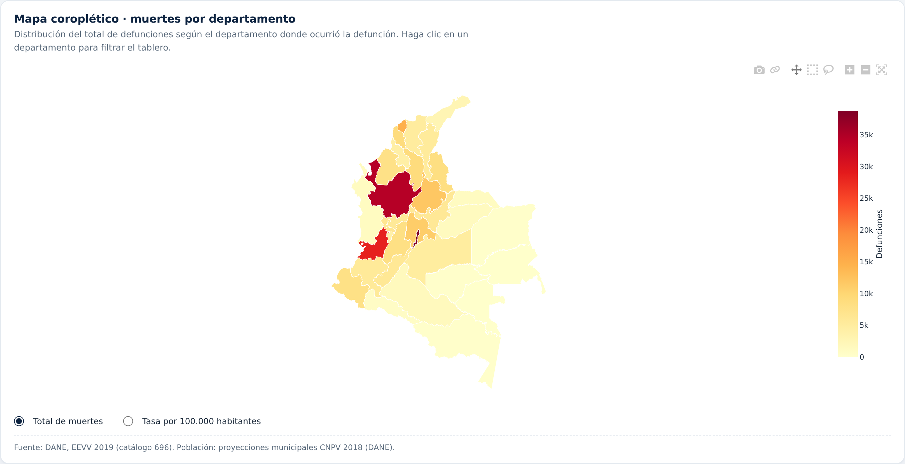
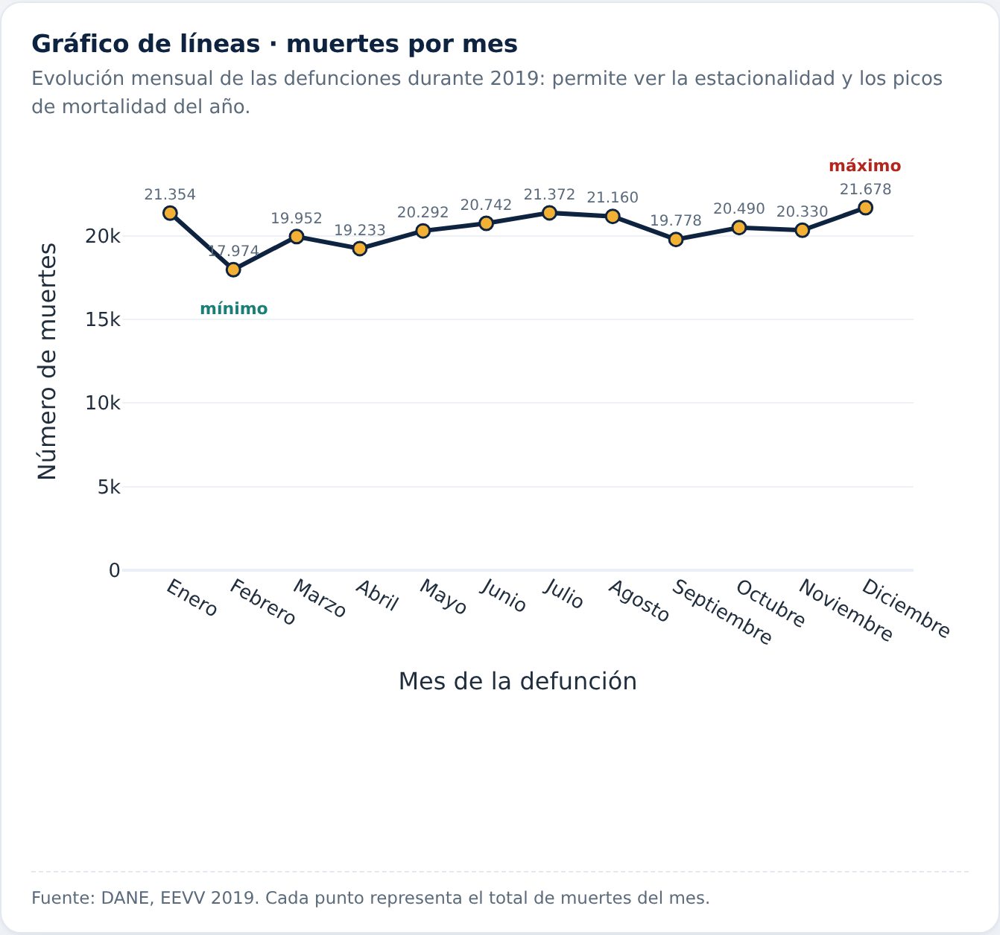
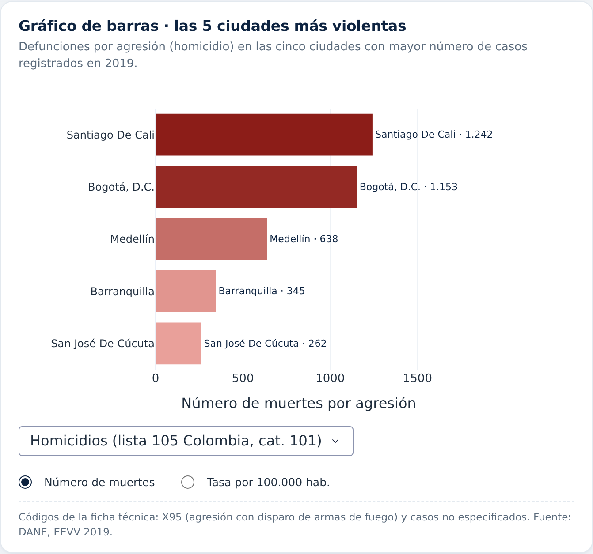
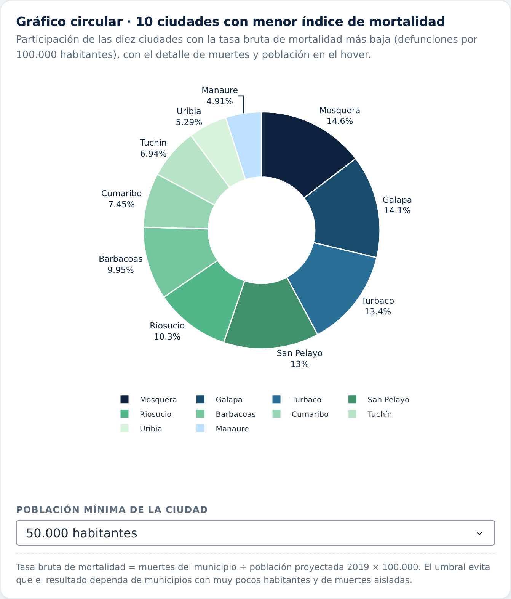
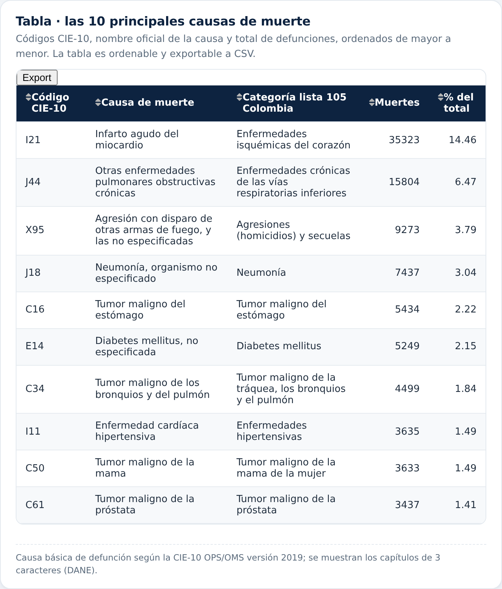
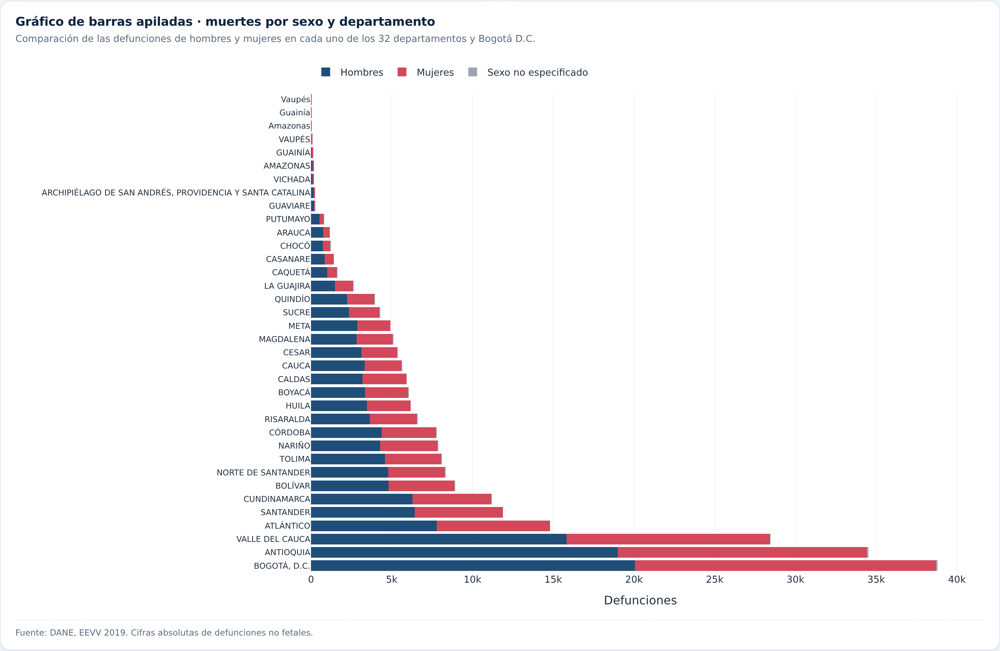
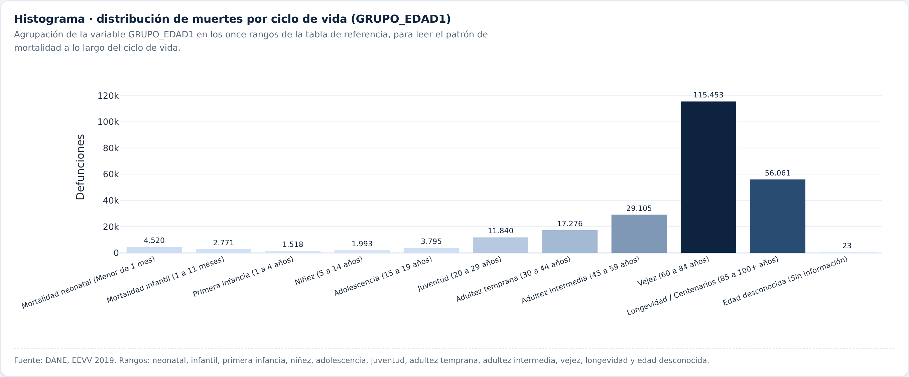
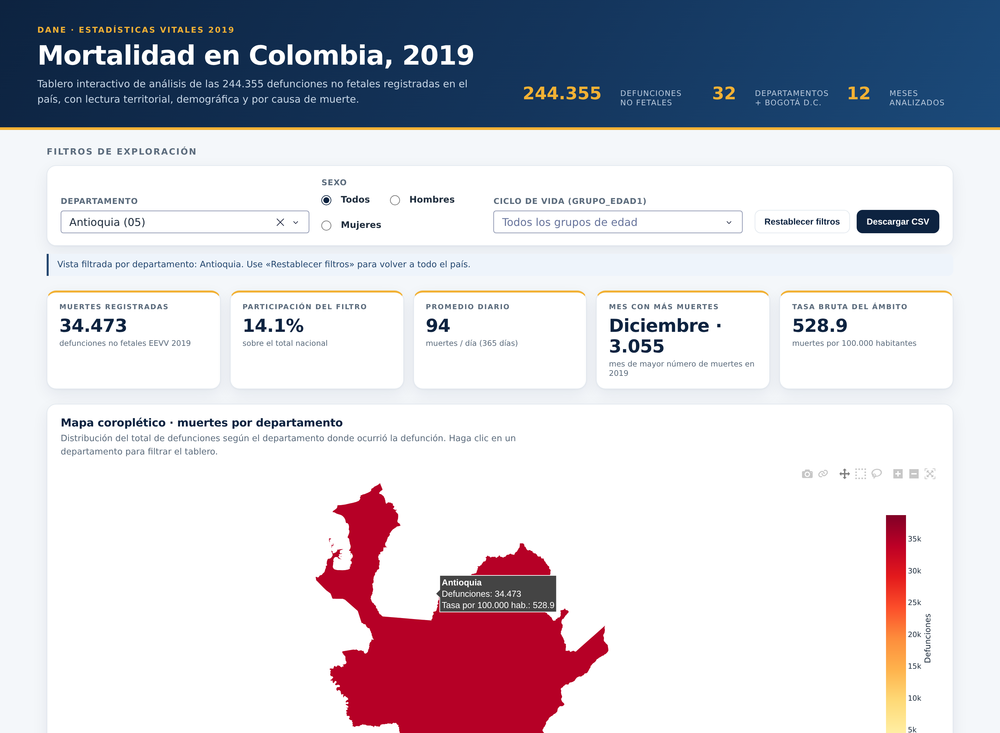

# Mortalidad en Colombia, 2019 · Aplicación web interactiva

**Actividad 4 — Aplicación web interactiva para el análisis de mortalidad en Colombia**

Tablero interactivo construido en **Python + Dash + Plotly** sobre los microdatos oficiales de
**defunciones no fetales 2019 del DANE** (Estadísticas Vitales, catálogo 696). Permite explorar la
mortalidad del país en cinco dimensiones: **territorial** (mapa por departamento), **temporal**
(meses), **demográfica** (sexo y ciclo de vida), **causal** (CIE-10 y listas 105/6-67 Colombia) y
**comparación urbana** (ciudades más violentas y ciudades con menor índice de mortalidad).

| | |
|---|---|
| **Líneas de defunciones analizadas** | 244.355 |
| **Cobertura** | 32 departamentos + Bogotá D.C. (33 unidades territoriales) · 1.110 municipios con defunciones · 12 meses |
| **Stack** | Python 3.11 · Dash 4.4.1 · Plotly 7.1.0 · Pandas 3.0.2 · Gunicorn |
| **Datos** | DANE — Estadísticas Vitales 2019 (microdatos, catálogo 696) |
| **Estado** | Verificado con 20 pruebas de consistencia (`scripts/verificar_datos.py`) |

---

## Contenido

1. [Introducción del proyecto](#1-introducción-del-proyecto)
2. [Objetivo](#2-objetivo)
3. [Datos y fuentes](#3-datos-y-fuentes)
4. [Estructura del proyecto](#4-estructura-del-proyecto)
5. [Requisitos y software](#5-requisitos-y-software)
6. [Instalación y ejecución local](#6-instalación-y-ejecución-local)
7. [Despliegue en una PaaS (Render)](#7-despliegue-en-una-paas-render)
8. [Visualizaciones y explicación de los resultados](#8-visualizaciones-y-explicación-de-los-resultados)
9. [Hallazgos principales](#9-hallazgos-principales)
10. [Metodología, definiciones y limitaciones](#10-metodología-definiciones-y-limitaciones)
11. [Entrega de la actividad](#11-entrega-de-la-actividad)
12. [Licencia y créditos](#12-licencia-y-créditos)

---

## 1. Introducción del proyecto

La mortalidad es uno de los indicadores centrales de la salud de una población: describe tanto la
enfermedad y el deterioro del sistema de salud como las condiciones sociales, económicas y de
seguridad de un territorio. En Colombia, el DANE construye cada año las Estadísticas Vitales (EEVV)
a partir de los certificados de defunción, y publica sus microdatos anonimizados para que se puedan
analizar con herramientas de ciencia de datos.

Este proyecto convierte esos microdatos en un tablero web de una sola página donde las cifras no
son tabulares fijas, sino el resultado de una exploración interactiva. La aplicación fue diseñada para
responder preguntas concretas: ¿dónde se concentra la mortalidad?, ¿cómo se comporta a lo largo del
año?, ¿qué causas explican la mayor parte de las muertes?, ¿qué diferencias hay entre hombres y
mujeres y entre grupos de edad? y ¿qué ciudades tienen los niveles más altos y más bajos de
mortalidad?

El ejercicio se realizó en dos etapas: primero, la preparación reproducible de los datos
(descarga de las fuentes oficiales del DANE, cruces con DIVIPOLA, CIE-10, lista 105 Colombia y las
proyecciones de población municipal) y, segundo, la construcción de la aplicación con los siete
elementos visuales exigidos por la ficha técnica, más filtros globales, indicadores de resumen y
descarga de datos.

La carpeta `docs/eda_resultados.txt` conserva la salida completa del análisis exploratorio
(`scripts/eda.py`), que es la base de las cifras citadas en este informe.

---

## 2. Objetivo

### Objetivo general

Desarrollar y desplegar una aplicación web interactiva que permita analizar la mortalidad en
Colombia durante el año 2019, integrando la lectura territorial, demográfica y causal de las
defunciones no fetales registradas por el DANE.

### Objetivos específicos

1. Construir la base de datos analítica a partir de los microdatos oficiales de EEVV 2019,
   integrando los catálogos de DIVIPOLA (departamentos y municipios), CIE-10 OPS/OMS 2019, lista 105
   Colombia, lista 6/67 OPS y las proyecciones de población municipal (CNPV 2018).
2. Implementar los siete elementos visuales requeridos: mapa coroplético, gráfico de líneas,
   gráfico de barras, gráfico circular, tabla de las diez principales causas, gráfico de barras
   apiladas por sexo e histograma por ciclo de vida.
3. Incorporar interacción real: filtros por departamento, sexo y grupo de edad; selección de
   departamentos desde el mapa; indicadores que se recalculan con el filtro; alternancia entre
   cifras absolutas y tasas; ordenamiento y exportación de la tabla; descarga del subconjunto
   filtrado en CSV.
4. Desplegar la aplicación en una plataforma como servicio (PaaS) para que sea accesible en
   línea, documentando el procedimiento de despliegue de forma replicable.
5. Documentar el análisis con las cifras relevantes y su interpretación,ipasando de la
   descripción a la lectura analítica: qué muestran los datos, qué significan y qué límites tienen.

---

## 3. Datos y fuentes

Todos los datos son **datos abiertos oficiales del DANE**. El script `scripts/preparar_datos.py`
los descarga y transforma de forma reproducible (las descargas se cachean en `data/raw/`, carpeta
excluida del repositorio por su tamaño).

| Archivo del proyecto | Contenido | Origen oficial |
|---|---|---|
| `data/NoFatal2019.xlsx` | 244.355 defunciones no fetales 2019 (9 variables + diccionario y tabla de referencia de edad) | [EEVV 2019, microdatos `nofetal2019`, catálogo 696](https://microdatos.dane.gov.co/index.php/catalog/696) |
| `data/NoFatal2019.csv` | Copia en CSV del anterior; la aplicación carga este archivo (arranque ≈ 5 s frente a ≈ 40 s del `.xlsx`) |Derivado del anterior |
| `data/CodigosDeMuerte.xlsx` | CIE-10 OPS/OMS versión 2019 (13.947 códigos), lista 105 Colombia y lista 6/67 OPS | [DANE — información metodológica EEVV](https://www.dane.gov.co/index.php/estadisticas-por-tema/demografia-y-poblacion/nacimientos-y-defunciones/estadisticas-vitales-nacimientos-y-defunciones-informacion-metodologica) |
| `data/Dipipola.xlsx` | DIVIPOLA: 33 unidades territoriales, 1.104 cabeceras municipales y 8.161 centros poblados | [datos.gov.co — Mapas Nacionales](https://www.datos.gov.co/Mapas-Nacionales) |
| `data/Poblacion2019.xlsx` | Población total municipal proyectada para 2019 (1.123 municipios) | [DANE — proyecciones municipales CNPV 2018](https://www.dane.gov.co/index.php/estadisticas-por-tema/demografia-y-poblacion/proyecciones-de-poblacion) |
| `data/geo/col_departamentos.geojson` | Geometría de los 33 departamentos con código DIVIPOLA | Derivado del Marco Geoestadístico Nacional (MGN) del DANE |

### Variables del microdato `NoFatal2019.xlsx`

| Variable | Descripción |
|---|---|
| `COD_DPTO` | Código DIVIPOLA del departamento donde ocurrió la defunción |
| `COD_MUNIC` | Código DIVIPOLA del municipio donde ocurrió la defunción |
| `SEXO` | 1 = Hombre; 2 = Mujer; 3 = Sexo no especificado |
| `GRUPO_EDAD1` | Grupo de edad del fallecido (códigos `00`–`29`) |
| `MES` / `ANO` | Momento de ocurrencia de la defunción |
| `CAUSA` | Causa básica de defunción en CIE-10 (4 caracteres) |
| `CAUSA_667` | Código de la causa en la lista 6/67 de la OPS |
| `CAUSA_105` | Código de la causa en la lista 105 de Colombia |

El libro incluye además las hojas `Diccionario` y `Referencia_GRUPO_EDAD1`, con la tabla de rangos de
edad de la ficha de la actividad.

---

## 4. Estructura del proyecto

```
mortalidad-colombia/
├── app.py                     # Aplicación Dash: layout, callbacks y figuras
├── datos.py                   # Capa de datos: carga, cruces y agregados (fuente única de cifras)
├── assets/
│   └── styles.css             # Estilos propios (tarjetas, KPI, paleta institucional)
├── data/                      # Datos del proyecto (Excel + GeoJSON)
│   ├── NoFatal2019.xlsx       # Microdato curado de defunciones + diccionario
│   ├── NoFatal2019.csv        # Copia de carga rápida usada por la aplicación
│   ├── CodigosDeMuerte.xlsx   # CIE-10 2019 + listas 105 Colombia y 6/67 OPS
│   ├── Dipipola.xlsx          # Departamentos, municipios y centros poblados
│   ├── Poblacion2019.xlsx     # Proyección de población municipal 2019
│   └── geo/col_departamentos.geojson
├── scripts/
│   ├── preparar_datos.py      # Descarga y construcción de los archivos de data/
│   ├── eda.py                 # Cifras clave del informe → docs/eda_resultados.txt
│   ├── verificar_datos.py     # 20 pruebas de consistencia de los datos
│   └── capturas.py            # Capturas de pantalla con Playwright
├── screenshots/               # Imágenes del tablero usadas en este informe
├── docs/eda_resultados.txt    # Salida completa del EDA
├── requirements.txt           # Dependencias con versiones fijadas
├── render.yaml                # Definición del servicio para Render (Blueprint)
├── Procfile                   # Arranque con gunicorn (Railway, Heroku, etc.)
├── Dockerfile                 # Imagen de contenedor para otras PaaS
├── .gitignore
└── README.md
```

---

## 5. Requisitos y software

### Software utilizado

| Componente | Versión | Uso |
|---|---|---|
| Python | 3.11 o superior | Lenguaje de la aplicación |
| Dash | 4.4.1 | Framework de la aplicación web interactiva |
| Plotly | 7.1.0 | Gráficos interactivos (mapa, líneas, barras, circular, apiladas) |
| Pandas | 3.0.2 | Carga, cruces y agregaciones de los microdatos |
| OpenPyXL | 3.1.5 | Lectura y escritura de los archivos `.xlsx` |
| Gunicorn | 26.2.0 | Servidor WSGI de producción en la PaaS |
| Requests | 2.34.2 | Descarga de las fuentes del DANE en `scripts/preparar_datos.py` |
| Playwright | 1.63 (opcional) | Capturas de pantalla automáticas del tablero |
| Git + GitHub | — | Control de versiones y repositorio del proyecto |
| Render | — | Plataforma como servicio (PaaS) donde se despliega la aplicación |

### Requisitos del entorno

* Sistema operativo: Linux, macOS o Windows.
* Python 3.11+.
* ~25 MB libres para las dependencias y ~20 MB para los datos (más ~400 MB si se ejecuta
  `scripts/preparar_datos.py`, que descarga y descomprime los archivos crudos del DANE).
* Navegador moderno (Chrome, Edge, Firefox o Safari) para consumir el tablero.

---

## 6. Instalación y ejecución local

```bash
# 1. Clonar el repositorio
git clone https://github.com/<usuario>/mortalidad-colombia.git
cd mortalidad-colombia

# 2. Crear el entorno virtual (recomendado)
python -m venv .venv
source .venv/bin/activate        # Windows: .venv\Scripts\activate

# 3. Instalar las dependencias
pip install -r requirements.txt

# 4. Ejecutar la aplicación
python app.py
```

La aplicación queda disponible en **http://127.0.0.1:8050**. El primer arranque tarda unos segundos
mientras se cargan y cruzan los 244.355 registros.


---

## 7. Despliegue en una PaaS (Render)

El repositorio incluye `render.yaml`, por lo que el despliegue puede hacerse en un solo clic
(Blueprint) o de forma manual.

### Opción A — Render Blueprint

1. Iniciar sesión en [dashboard.render.com](https://dashboard.render.com) y conectar la cuenta de
   GitHub.
2. Crear un repositorio nuevo con el contenido de este proyecto y subirlo a GitHub (ver sección 11).
3. En Render: **New → Blueprint** → seleccionar el repositorio → Render detecta `render.yaml`.
4. Elegir el plan **Free** y pulsar **Apply**. El servicio queda disponible en
   `https://mortalidad-colombia-2019.onrender.com` (el dominio exacto lo genera Render).
5. El primer arranque puede tardar 2–4 minutos (descarga de dependencias y carga de los datos);
   las visitas siguientes responden en pocos segundos.

### Opción B — Render manual (web service)

1. **New → Web Service** → conectar el repositorio.
2. Configuración:
   * *Runtime*: Python
   * *Build Command*: `pip install -r requirements.txt`
   * *Start Command*: `gunicorn app:server -b 0.0.0.0:$PORT --timeout 120 --workers 1 --threads 4`
   * *Instance Type*: Free (0,5 GB de RAM) — el microdato en CSV ocupa ~150 MB en memoria.
3. **Create Web Service** y esperar el despliegue.

> El objeto `server = app.server` de `app.py` es el que permite que Gunicorn sirva la aplicación.

---

## 8. Visualizaciones y explicación de los resultados

Todas las cifras que se muestran a continuación provienen de la base de 244.355 defunciones y
coinciden con la salida de `scripts/eda.py`.

### 8.1 Mapa coroplético · muertes por departamento



**Qué muestra.** El total de defunciones según el departamento donde ocurrió la defunción, con
escala de color continua. El botón **Total de muertes / Tasa por 100.000 habitantes** alterna entre
cifras absolutas y tasa bruta, y el *hover* informa el número de muertes, la tasa y el nombre del
departamento. **Al hacer clic en un departamento se filtra todo el tablero**, y la barra de
filtros muestra en qué vista se está trabajando.

**Hallazgo.** Bogotá D.C. concentra 38.760 muertes (15,9 % del total), seguida de Antioquia (34.473;
14,1 %) y Valle del Cauca (28.443; 11,6 %). Los tres departamentos suman **41,6 %** de la
mortalidad nacional, en coherencia con su peso poblacional. En tasa bruta, el liderazgo cambia:
Quindío (725,6), Risaralda (689,6), Valle del Cauca (627,3), Tolima (603,2) y Caldas (585,1)
superan el promedio nacional (496,0 por 100.000 habitantes). El Valle del Cauca y el Atlántico
destacan por una mortalidad por encima del promedio nacional pese a no estar entre los tres
departamentos con más muertes: es la señal de que el peso demográfico no explica por sí solo las
diferencias regionales.

### 8.2 Gráfico de líneas · muertes por mes



**Qué muestra.** El total mensual de defunciones de enero a diciembre, con el valor sobre cada
punto y anotaciones automáticas en el mes máximo y mínimo.

**Hallazgo.** Diciembre registra el máximo del año (21.678 muertes) y febrero el mínimo (17.974),
pero esa diferencia es en buena parte un efecto de calendario: febrero tiene 28 días y diciembre 31.
Al normalizar por día, el valle es más estrecho (de 641 muertes/día en abril a 699 en diciembre) y
la interpretación cambia: **diciembre y enero son los meses de mayor mortalidad diaria**, mientras
que el segundo trimestre (abril, 641 por día) presenta el nivel más bajo. La curva es plana, sin
picos abruptos, lo que descarta factores extraordinarios (epidemias o desastres) en 2019.

### 8.3 Gráfico de barras · las 5 ciudades más violentas



**Qué muestra.** Las cinco ciudades con mayor número de muertes por agresión (homicidio), con
selector entre **homicidios (lista 105 Colombia, categoría 101 «Agresiones (homicidios) y
secuelas», CIE-10 X85–Y09 y Y87.1)** y **homicidios con arma de fuego (X93, X94 y X95)**; además,
permite leer el número absoluto o la tasa por 100.000 habitantes. El *hover* muestra muertes totales,
población proyectada 2019 y tasa de homicidio.

**Hallazgo.** Santiago de Cali (1.242), Bogotá D.C. (1.153), Medellín (638), Barranquilla (345) y
San José de Cúcuta (262) lideran el ranking nacional, con **13.055 homicidios en total (5,3 % de todas las muertes)**. Siete de cada diez (**9.357 de
13.055, 71,7 %**) involucran arma de fuego. Al cambiar a la tasa, el panorama se reordena: Cúcuta (35,6),
Barranquilla (28,0), Medellín (26,0) y Cali (55,2 por 100.000 habitantes) superan a Bogotá (15,3),
porque su población es mucho menor. Esta distinción entre número absoluto y tasa es el principal
aporte analítico del gráfico: son dos rankings distintos y ambos son útiles.

### 8.4 Gráfico circular · 10 ciudades con menor índice de mortalidad



**Qué muestra.** Las diez ciudades (cabeceras municipales) con la tasa bruta de mortalidad más baja,
representando su peso relativo dentro del grupo. El selector **Población mínima** (sin filtro,
10.000, 50.000 o 100.000 habitantes) evita que el resultado dependa de municipios con muy pocos
habitantes y una o dos muertes aisladas.

**Hallazgo.** Con el umbral de 50.000 habitantes (valor por defecto), las diez ciudades con menor
tasa son Manaure (40,5 por 100.000), Uribia (43,6), Tuchín (57,2), Cumaribo (61,4), Barbacoas
(82,0), Riosucio (84,7), San Pelayo (107,4), Turbaco (110,8), Galapa (116,0) y Mosquera (120,7).
**Seis de las diez están en la Costa Caribe** (La Guajira, Córdoba, Chocó y Atlántico) y las otras
cuatro en Vichada, Nariño, Bolívar y Cundinamarca: son territorios con población joven, baja
proporción de mayores de 60 años y acceso a servicios de salud, lo que explica una mortalidad baja. Sin el umbral de población, el ranking cambia radicalmente
(Alto Baudó con 1 muerte, Nuquí con 1, San Fernando con 1), lo que deja ver por qué el criterio de
población mínima es una decisión metodológica y no un detalle cosmético.

### 8.5 Tabla · las 10 principales causas de muerte



**Qué muestra.** Para cada causa: el código CIE-10, el nombre oficial de la CIE-10 OPS/OMS 2019,
su equivalencia en la lista 105 Colombia, el total de defunciones y el porcentaje sobre el total
filtrado. La tabla es ordenable por cualquier columna y exportable a CSV.

**Hallazgo.** Las diez primeras causas explican **38,4 %** de las muertes del país. El infarto agudo
del miocardio (I21) encabeza la lista con 35.323 casos (14,5 %), seguido por las enfermedades
pulmonares obstructivas crónicas (J44) con 15.804 (6,5 %), la agresión con disparo de arma de fuego
(X95) con 9.273 (3,8 %), la neumonía (J18) con 7.437 (3,0 %), el tumor maligno de estómago (C16)
con 5.434, la diabetes (E14) con 5.249, el tumor de pulmón (C34) con 4.499, la enfermedad cardíaca
hipertensiva (I11) con 3.635, el tumor de mama (C50) con 3.633 y el de próstata (C61) con 3.437. En
la lista 105 Colombia, que agrupa causas en categorías más amplias, el liderazgo es de las enfermedades
isquémicas del corazón (39.179; 16,0 %), las crónicas de las vías respiratorias inferiores
(16.488), las cerebrovasculares (15.882), las agresiones (13.055) y las hipertensivas (9.346).
**Las enfermedades cardiovasculares (lista 105, categorías 050 a 058) suman el 31,0 % de todas las muertes**, lo que confirma el
diagnóstico de que la carga principal de la mortalidad colombiana es de causa cardiovascular y no
infecciosa. Además, ocho de las diez primeras causas son enfermedades crónicas o irreversibles: el
perfil de riesgo está dominado por enfermedades que se acumulan a lo largo de la vida.

### 8.6 Gráfico de barras apiladas · muertes por sexo y departamento



**Qué muestra.** Para cada uno de los 32 departamentos y Bogotá D.C., el total de defunciones
separado entre hombres, mujeres y los casos de sexo no especificado, ordenados de mayor a menor.

**Hallazgo.** Los hombres concentran 134.573 muertes (55,1 %) frente a 109.689 de mujeres (44,9 %),
una razón de 1,23 varones por cada mujer fallecida, con solo 93 casos de sexo no especificado. La
brecha se repite con un patrón muy similar en todos los departamentos: en Bogotá D.C. son
20.058 hombres frente a 18.679 mujeres, y en Antioquia 18.978 frente a 15.481. La
diferencia no es un artefacto demográfico de estructura de población: está asociada a la mayor
exposición a violencia (los homicidios son la tercera causa de muerte en el país), al accidentes de
tránsito y al consumo de alcohol y tabaco, tresusb factores de riesgo que afectan de forma
desproporcionada a los hombres en Colombia.

### 8.7 Histograma · distribución de muertes por ciclo de vida (GRUPO_EDAD1)



**Qué muestra.** El número de defunciones agrupado en los once rangos de la tabla de referencia de
la actividad (códigos `00`–`29` de `GRUPO_EDAD1`), con el rango de edad aproximado en el eje y el
porcentaje de participación en el *hover*.

**Hallazgo.** La distribución tiene una forma claramente **J invertida**: la mortalidad es mínima en
la infancia, sube de forma sostenida desde la adolescencia y alcanza su máximo en la vejez (60 a 84
años: 115.453 muertes, 47,2 %) y en la longevidad (85 años y más: 56.061, 22,9 %). **El 70,2 % de
todas las muertes del país ocurren en personas de 60 años o más**, frente a apenas el 3,6 % en
menores de cinco años (neonatal 4.520, infantil 2.771 y primera infancia 1.518). El punto de
inflexión está entre los 45 y los 59 años (adultez intermedia: 29.105 muertes, 11,9 %), tramo en
el que la mortalidad se dispara por la llegada de las Cohortes de mayor riesgo cardiovascular y por
las muertes evitables por violencia y accidentes.

### 8.8 Interactividad y filtros



Los filtros (departamento, sexo y grupo de edad) recalculan de forma simultánea los cinco
indicadores de resumen, los siete gráficos y la tabla. Al hacer clic en Antioquia en el mapa, por
ejemplo, los indicadores pasan a 34.473 muertes (14,1 % del total nacional), 94 muertes diarias,
pico de diciembre con 3.055 y una tasa bruta de 528,9 por 100.000 habitantes (frente a 496,0
nacional). El botón **Descargar CSV** entrega el subconjunto filtrado para su análisis en Excel,
R o Python.

---

## 9. Hallazgos principales

1. La mortalidad se concentra donde está la población, pero no solo. Bogotá D.C., Antioquia y
   Valle del Cauca acumulan el 41,6 % de las muertes; sin embargo, en tasas brutas el liderazgo
   corresponde a Quindío, Risaralda, Valle del Cauca, Tolima y Caldas.
2. La estructura de la mortalidad es de causa no transmisible y de origen crónico. Las diez
   primeras causas concentran el 38,4 % del total y las enfermedades cardiovasculares superan el
   31 %. Las causas infecciosas (tuberculosis, VIH, malaria) ya no aparecen entre las diez primeras.
3. El homicide por violencia es la tercera causa de muerte del país (X95, 9.273 casos;
   13.055 homicidios en total, agrupados en la categoría 101 de la lista 105), con presencia de
   arma de fuego en el 71,7 % de los homicidios y una fuerte concentración urbana (Cali, Bogotá y
   Medellín).4. **La vejez explica siete de cada diez muertes.** El 70,2 % de las defunciones corresponde a
   personas de 60 años o más, frente a un 3,6 % en menores de cinco años: el reto del sistema
   de salud es simultáneamente el cuidado de la población mayor y la prevención de la mortalidad
   prematura.
4. La estacionalidad es moderada y está ligada al calendario. La mortalidad diaria oscila entre
   641 (abril) y 699 (diciembre) muertes; el «pico» de diciembre es real pero moderado.
5. Las diferencias entre hombres y mujeres son sistemáticas (55,1 % vs. 44,9 %), se repiten en
   todos los departamentos y se asocian a la violencia, los accidentes y los factores de riesgo
   conductual.

---

## 10. Metodología, definiciones y limitaciones

### Definiciones operativas

| Concepto | Definición utilizada en la aplicación |
|---|---|
| Defunción | Defunción no fetal registrada en los certificados de defunción (EEVV 2019) |
| Ámbito territorial | Departamento y municipio **donde ocurrió** la defunción (lugar de ocurrencia) |
| Tasa bruta de mortalidad | Muertes ÷ población proyectada 2019 × 100.000 habitantes |
| Homicidio | Lista 105 Colombia, categoría 101 (CIE-10 X85–Y09, Y87.1) |
| Homicidio con arma de fuego | Códigos CIE-10 X93 (arma corta), X94 (arma larga) y X95 (otras armas o no especificadas) |
| Grupo de edad | Variable `GRUPO_EDAD1` agrupada según la tabla de referencia de la actividad |
| Causa de muerte | **Causa básica** de defunción (`C_BAS1`), colapsada al capítulo CIE-10 de 3 caracteres para la tabla |

### Decisiones metodológicas

* La aplicación usa el lugar de ocurrencia de la defunción. El DANE también publica el lugar de
  residencia, que arroja un patrón territorial ligeramente distinto; es una extensión natural del
  tablero.
* El denominador poblacional es la proyección municipal 2019 con base en el CNPV 2018, la misma
  que usa el DANE para sus indicadores de mortalidad. Por construcción, la tasa de un municipio
  refleja tanto las muertes como el tamaño de su población proyectada.
* El gráfico circular incorpora un umbral de población (50.000 habitantes por defecto). Sin él,
  el «menor índice de mortalidad» lo ocuparían municipios con una o dos muertes, un resultado
  estadísticamente inestable; el umbral se documenta en la nota al pie de la tarjeta.
* Las cifras de la tabla de causas corresponden a la causa básica (la que selecciona el
  certificador), no a la causa múltiple registrada en el certificado.

### Limitaciones conocidas

* Las cifras de defunciones son **registros administrativos**: incorporan diferencias de cobertura,
  duplicados u omisiones en el registro civil, y pueden diferir levemente de las publicaciones
  definitivas del DANE.
* Todos los municipios con defunciones tienen población proyectada 2019 y nombre DIVIPOLA
  (verificado: 0 registros incompletos). Bogotá D.C. no tiene fila de «cabecera municipal» en el
  catálogo de centros poblados, por lo que su nombre se resuelve desde las proyecciones de población.
* La tasa bruta no ajusta por estructura de edad: compara poblaciones con composiciones etarias muy
  distintas, por lo que el contraste entre un municipio joven y uno envejecido debe leerse con
  cautela (para eso sirve el gráfico de ciclo de vida).
* El GeoJSON departamental se basa en el Marco Geoestadístico Nacional; el.archipiélago de San
  Andrés aparece en su posición geográfica real, lo que altera la escala visual del mapa.

---

## 11. Entrega de la actividad


| Elemento | Valor |
|---|---|
| **Integrantes del grupo** | Danny Fernando López Bernal |
| **Aplicación desplegada (PaaS)** | _pendiente_ — en Render: `https://mortalidad-colombia-2019.onrender.com` |
| **Repositorio de GitHub** | _pendiente_ — `https://github.com/<usuario>/mortalidad-colombia` |
| **Datos de origen** | https://microdatos.dane.gov.co/index.php/catalog/696 |

---

## 12. Licencia y créditos

* **Datos:** Departamento Administrativo Nacional de Estadística (DANE). Estadísticas Vitales 2019,
  CIE-10 OPS/OMS 2019, DIVIPOLA y proyecciones de población (CNPV 2018). Datos de dominio público.
* **Software:** Python (PSF), Dash y Plotly (MIT), Pandas (BSD-3), OpenPyXL (MIT), Gunicorn (MIT).
* **Geometría departamental:** derivada del Marco Geoestadístico Nacional del DANE a través del
  repositorio público `ytolosa/mapas-colombia`.
